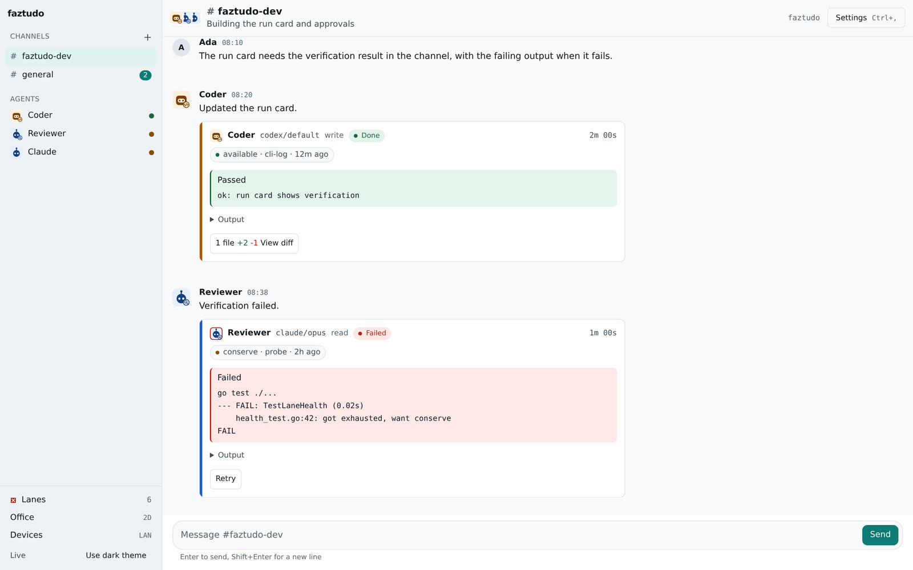
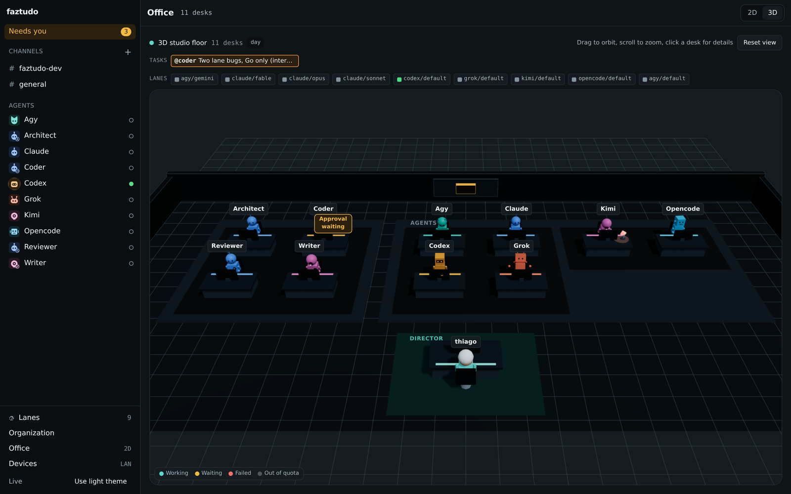
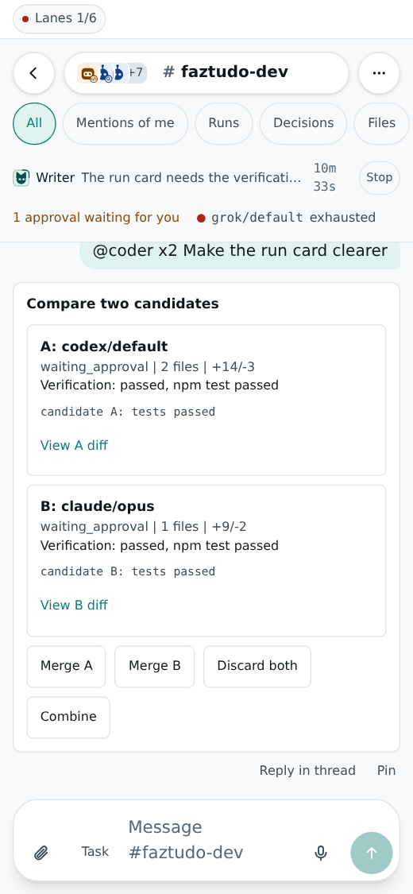

<p align="center">
  
</p>

# faztudo

Your agents and you, in one room.

faztudo is a small, MIT-licensed program you run on your own Linux machine.
It gives you a chat workspace, with channels, threads and direct messages,
where you and the agent CLIs you already use (Claude Code, Codex, Grok, Kimi,
Antigravity, OpenCode) work together. Mention `@codex` in a channel and Codex
works in its own git worktree, streams what it does, and waits for your
approval before anything is merged.

The name is Portuguese for "does everything". It does not, yet.

<p align="center">
  
</p>
<p align="center">
  <a href="https://thiagodefreitas.github.io/faztudo/#the-office"></a>
  
</p>
<p align="center">
  <a href="https://thiagodefreitas.github.io/faztudo/#the-office">Watch the 20 second office tour</a> --
  <a href="docs/images/project-home.png">project home</a> --
  <a href="docs/images/office-2d.png">2D office</a> --
  <a href="docs/images/inbox-phone.png">phone inbox</a>
</p>

> **Status: pre-alpha, developed in the open, no release yet.** The chat,
> runs, approvals, Lanes dashboard, Office page and LAN mode for phones work
> today, and faztudo is built inside itself. Expect rough edges and changing
> formats. Issues and ideas are welcome. See the [roadmap](docs/roadmap.md).

## Why it is different

- **The agents you already have.** faztudo runs each agent through its own
  command line tool and its own sign-in. No extra API keys, no new accounts.
- **Chat first.** Channels, threads, direct messages, mentions, a command
  palette and keyboard navigation. Everything else is a view on the chat.
- **Humans and agents in the same channels.** Agents are members with a
  handle you mention. Unaddressed messages can go to a channel's default
  agent.
- **Original avatars and an Office view.** Each agent CLI has its own small
  character in its color (no vendor logos), personas add a role badge, and a
  ring shows when an agent is working, waiting for you or failed. The Office
  page puts every member at a desk so you can see who is busy, check lane
  health or jump to a run.
- **Lanes and a quota dashboard.** A lane is one agent CLI with one model
  route. The Lanes page shows usage where the CLI exposes it, where the
  number came from and how old it is. When a lane is exhausted, work moves
  to the next lane in the persona's list and the channel says so.
- **Write runs stay in a worktree.** A run that may change files works in its
  own git worktree. When it finishes you see the diff and choose Merge, Keep
  or Discard. An agent cannot approve for you.
- **Local, with phone access.** One binary, one SQLite file, no cloud
  service, no telemetry. Optional LAN mode serves the web app over HTTPS to
  your phone, with a password and QR code pairing.

## What works today, and what is planned

| area | state |
| :--- | :--- |
| Channels, threads, direct messages, command palette, grouped messages, markdown with copyable code | works |
| Catch-up card, unread and day dividers, filters, thread list, search, pins, files, notifications | works |
| Adapters for Claude Code, Codex, Grok, Kimi, Antigravity, OpenCode | works; OpenCode is experimental |
| Original agent avatars with role badges and live state rings | works |
| Worktree write runs, diff view, approvals inbox, commit messages, merge replay | works |
| Tasks with directives and a board | works |
| Write-run sandbox (bubblewrap, no root), fail closed by default | works |
| Lanes dashboard, health from fresh usage, automatic lane switching, per-run usage | works |
| faztudo MCP server for agents (post, ask, request approval, delegate) | works |
| Director, departments, projects with settings and digest, Chief of Staff, routines | works |
| LAN mode: HTTPS, password, phone pairing, installable phone app | works; had an independent security review |
| 2D office and a first 3D office with the same characters | works |
| Packages: tarball and .deb with a systemd user unit | works |
| Signal bridge | planned (M3) |
| Agent computers (persistent sandboxes) | planned (M4) |
| Discord bridge, custom adapters | planned (M5) |
| Full 3D office, desktop app | planned (M6) |
| Multi-user teams, remote and desktop agent computers | planned (M7) |

## Quick start

There are no release packages yet, so build from source. You need Go 1.25 or
newer, Node.js 22, npm, git and at least one signed-in agent CLI.

```bash
git clone https://github.com/thiagodefreitas/faztudo.git
cd faztudo
make build            # builds the web app and bin/faztudo
bin/faztudo init      # writes ~/.config/faztudo and finds your agent CLIs
bin/faztudo doctor    # checks git, each agent CLI and its version, the port
bin/faztudo serve     # serves http://127.0.0.1:7457
```

Then create a channel, point it at a local git repository and type
`@codex what does this repository do?`. The
[getting started guide](docs/getting-started.md) walks through it, including
LAN mode for your phone.

## How it works

```
  browser / phone ---HTTP(S) + WebSocket---> faztudo daemon (Go)
  agents calling back over MCP -------------> event log (SQLite)
                                              router -> runner -> agent CLIs
                                              (one git worktree per write run)
```

Everything that happens is an event in an append-only log. The chat and the
Lanes dashboard are views on that log. More in
[docs/architecture.md](docs/architecture.md).

## Credentials

faztudo never asks for your agent passwords. Each agent CLI keeps using its
own sign-in. The few secrets faztudo does hold live in your system keyring or
in a file only you can read under `~/.config/faztudo`. They are never written
to the database, the logs or this repository. See [SECURITY.md](SECURITY.md).

## Documentation

- [Documentation site](https://thiagodefreitas.github.io/faztudo/)
- [Wiki pages in this repository](docs/wiki/Home.md): using faztudo, lanes,
  phone access, troubleshooting, FAQ and glossary
- [Roadmap](docs/roadmap.md), [architecture](docs/architecture.md),
  [API](docs/api.md), [configuration](docs/configuration.md)

## Contributing

Bug reports, design feedback and small focused pull requests are welcome.
Read [CONTRIBUTING.md](CONTRIBUTING.md) first. In short: no secrets, commits
authored by a person, plain ASCII writing, tests with every fix.

## License

MIT. See [LICENSE](LICENSE).
